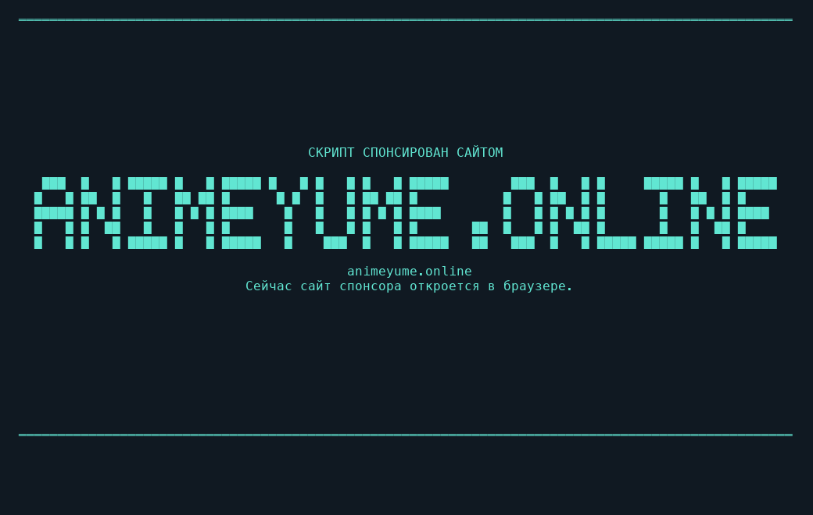

# G1 ACQ Plus setup

Windows: LDPlayer. macOS Apple Silicon: MuMu.

Установка отдельного Python 3.13, настройка Android root выбранного эмулятора
и меню предложений, которые Google Play возвращает для вашего аккаунта.
Источник идентификаторов — [Dgkncn/g1-acq-plus](https://github.com/Dgkncn/g1-acq-plus).
Оригинальный iOS/Shadowrocket-модуль не запускается в Android напрямую.

Спонсор: [animeyume.online](https://animeyume.online).
После успешной подготовки каталога скрипт показывает крупный баннер и один раз
открывает сайт спонсора в браузере. Нажмите Enter в терминале, чтобы перейти к меню.

Партнёрская загрузка Windows: [LDPlayer](https://leap.ldplayer.gg/T4WsicN6b).
Установите эмулятор с открывшейся страницы, затем вернитесь в скрипт.
Доступность оплачиваемого оффера и условия начисления определяет партнёрский кабинет;
наличие ссылки само по себе не гарантирует оплату за скачивание.

Полная инструкция и ограничения — [README-RU.txt](README-RU.txt).
Оформление подписки подтверждается вручную в окне Google Play.

Из исходников: `install/windows.ps1` или `zsh install/mac.zsh`.
Самостоятельные установщики создаются командой `python3 tools/build_release.py` в `dist/`.
Архивы включают только явно перечисленные файлы, без локальных отчётов и среды Python.

Проверены установка среды на Mac, 27 Python-тестов, 10 офлайн-проверок Billing bridge
и 4 проверки Windows runtime через PowerShell. Полный цикл в реальном Android
и установка на Windows в текущем окружении не проверены.

Команды для вставки: [COMMANDS.txt](COMMANDS.txt).

Локальный запуск Windows: извлеките все файлы из `G1AcqPlus-Windows-Local.zip` и запустите `START.cmd`. Интернет потребуется для установки среды и эмулятора.

Команда загрузки останавливается при HTTP/сетевой ошибке, проверяет наличие файла и его SHA256 до запуска. Шесть регрессионных проверок: `tests/windows-bootstrap.ps1`.
